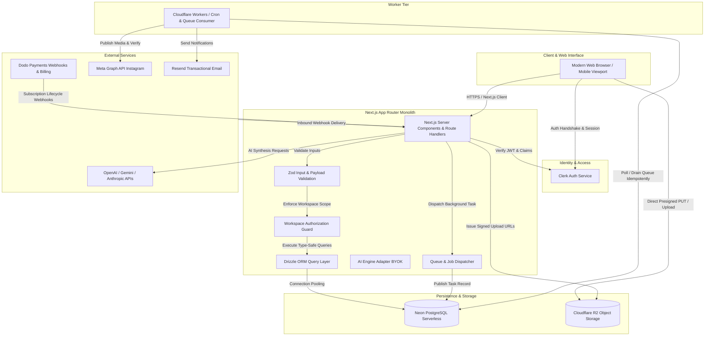

# System Architecture & Technical Specifications — Omniflow

**Version:** 1.0.0  
**Status:** Approved Architecture  
**Product:** Omniflow  

---

## 1. High-Level Architectural Topology

Omniflow adopts a **Modular Monolith** architecture for rapid MVP velocity, strict type coherence, and straightforward serverless deployment, complemented by **Cloudflare Workers** for background job dispatch and webhook execution.



---

## 2. Component Specifications

### 2.1 Next.js App Router (Fullstack Application)
- **Framework:** Next.js 14+ (App Router, Server Actions, Route Handlers).
- **Language:** TypeScript 5+ (Strict Mode enabled: `noImplicitAny: true`, `strictNullChecks: true`).
- **Styling & UI:** Tailwind CSS, `shadcn/ui` (Radix UI primitives), Lucide React icons.
- **Form Management:** `react-hook-form` paired with `@hookform/resolvers/zod`.
- **Charts & Visualization:** Recharts for analytics; React Flow (`@xyflow/react`) for node-based automation workflow builder.

### 2.2 Authentication & Multi-Tenant Authorization
- **Provider:** Clerk.
- **Workspace Model:**
  - Every user belongs to one or more `workspaces`.
  - The current active workspace ID is stored in a secure cookie/header or URL context and verified on every server-side operation.
  - Role-Based Access Control (RBAC): `OWNER`, `ADMIN`, `MEMBER`.
- **Server Guard:** A centralized helper `requireWorkspaceAuth(req)` resolves the authenticated Clerk user, ensures active membership in the requested workspace, and binds the `workspaceId` to all downstream database operations. Cross-tenant leakage is strictly prevented at the query construction layer.

### 2.3 Database Tier (Neon PostgreSQL + Drizzle ORM)
- **Engine:** Neon Serverless PostgreSQL with connection pooling (`@neondatabase/serverless` with WebSocket/HTTP drivers for edge/serverless compatibility).
- **ORM:** Drizzle ORM for zero-overhead, completely type-safe SQL queries and schema migrations via `drizzle-kit`.
- **Safety Guarantees:**
  - Foreign key cascades configured appropriately.
  - Composite indexes on `(workspace_id, created_at)` and `(workspace_id, status)` for fast tenant-scoped queries.
  - Deduplication indexes on webhook events and job idempotency keys.

### 2.4 File Storage (Cloudflare R2)
- **Protocol:** S3-compatible AWS SDK v3 (`@aws-sdk/client-s3`, `@aws-sdk/s3-request-presigner`).
- **Zero Server Egress:** The web server generates short-lived presigned upload URLs (PUT). The browser streams the media file directly to Cloudflare R2.
- **Security Check:** Pre-signed URL generation strictly validates workspace ownership, target path prefixing (`workspaces/{workspaceId}/media/{assetId}`), MIME types, and maximum byte lengths.

### 2.5 Background Queue & Publishing Engine
- **Idempotent Job Pipeline:**
  1. User schedules a post or triggers an action.
  2. A row is inserted in `publishing_jobs` with status `PENDING`, an `idempotency_key`, and `run_at` timestamp.
  3. A lightweight scheduler worker or API cron runs at defined intervals, queries `run_at <= NOW() AND status = 'PENDING'`, acquires a row-level lock (`FOR UPDATE SKIP LOCKED`), and transitions status to `PROCESSING`.
  4. The job calls the Meta Graph API publishing adapter.
  5. Upon completion, status is set to `COMPLETED` and `external_post_id` is recorded.
  6. On failure, error details are saved, retry counter increments, and exponential backoff is scheduled up to 3 attempts before marking `FAILED`.

### 2.6 Meta Instagram Automation Engine
- **OAuth & Account Handshake:** Instagram Graph API access via official Facebook Login for Business.
- **Security:** Long-lived Page Access Tokens are encrypted with AES-256-GCM before storage in `social_tokens`.
- **Webhooks:** Inbound webhook endpoint `/api/webhooks/meta` verifies the `X-Hub-Signature-256` HMAC against `META_APP_SECRET`.
- **Comment-to-DM Pipeline:**
  - Inbound webhook parses `changes` array for `field: "comments"`.
  - Checks if comment belongs to an active post or account with an active `automation_rule`.
  - If keyword conditions match:
    1. Sends public reply via `POST /{comment-id}/replies` (if enabled).
    2. Sends private message via `POST /{page-id}/messages` using `recipient: { comment_id }`.
    3. Logs execution in `automation_executions` and captures lead in `leads`.

### 2.7 AI Provider Abstraction (BYOK Architecture)
- **Multi-Engine Client:** Unified interface supporting OpenAI (`gpt-4o-mini`, `gpt-4o`), Google Gemini (`gemini-1.5-flash`), and Anthropic (`claude-3-5-sonnet`).
- **BYOK (Bring Your Own Key):** Creators can either use platform-provided default quota or supply their own API keys stored in workspace settings.
- **Fail-Safe Fallback:** If external API keys fail or exceed rate limits, descriptive errors are provided without crashing user sessions.

### 2.8 Billing & Entitlement Engine (Dodo Payments)
- **Integration:** Dodo Payments checkout sessions for plan subscriptions (`Free`, `Creator`, `Pro`).
- **Webhook Handling:** Verifies signed events (`subscription.created`, `subscription.updated`, `subscription.cancelled`).
- **Server-Side Entitlement Check:**
  - Before scheduling post: `count(posts in current billing period) < tier_limit`.
  - Before creating automation: `count(active_automations) < tier_limit`.
  - Before executing AI research: `count(monthly_research_reports) < tier_limit`.

---

## 3. Directory Layout (Modular Monolith)

```
omniiflow/
├── src/
│   ├── app/                      # Next.js App Router pages and route handlers
│   │   ├── (auth)/               # Clerk authentication screens (sign-in, sign-up)
│   │   ├── (marketing)/          # Landing page, pricing, features
│   │   ├── (dashboard)/          # Authenticated creator dashboard routes
│   │   │   ├── dashboard/
│   │   │   │   ├── page.tsx      # Main executive dashboard
│   │   │   │   ├── research/     # AI Content Research lab
│   │   │   │   ├── content/      # Content Studio & editor
│   │   │   │   ├── calendar/     # Interactive publishing calendar
│   │   │   │   ├── media/        # Cloudflare R2 media library
│   │   │   │   ├── automation/   # DM Automation & Workflow builder
│   │   │   │   ├── publishing/   # Publishing queue & execution logs
│   │   │   │   ├── inbox/        # Unified Direct Message inbox
│   │   │   │   ├── leads/        # Creator CRM & lead pipeline
│   │   │   │   ├── analytics/    # Creator performance insights
│   │   │   │   ├── accounts/     # Social account connections
│   │   │   │   ├── billing/      # Dodo Payments plan management
│   │   │   │   └── settings/     # Workspace & BYOK settings
│   │   └── api/                  # REST API endpoints & Webhooks
│   │       ├── webhooks/         # Meta, Clerk, Dodo Payments webhooks
│   │       ├── r2/               # Presigned upload URL generation
│   │       ├── publishing/       # Job runner triggers
│   │       └── ai/               # AI generation endpoints
│   ├── components/               # Reusable UI & Business components
│   │   ├── ui/                   # shadcn/ui primitives (button, dialog, etc.)
│   │   ├── layout/               # Sidebar, header, workspace switcher
│   │   ├── dashboard/            # Metrics widgets, activity feeds
│   │   ├── content/              # Script generator, preview card
│   │   ├── automation/           # Flow builder nodes, keyword rules
│   │   └── media/                # Asset card, uploader dropzone
│   ├── lib/                      # Core backend and utility modules
│   │   ├── db/                   # Drizzle schema, client, migrations
│   │   │   ├── schema/           # Normalized table definitions
│   │   │   └── index.ts          # Pooled Neon client instance
│   │   ├── auth/                 # Clerk helper & workspace authorization guards
│   │   ├── integrations/         # Meta Graph, Resend, Cloudflare R2 adapters
│   │   │   ├── meta/             # Instagram OAuth, Comments, Publishing, DMs
│   │   │   ├── r2/               # S3 presigner & asset management
│   │   │   └── email/            # Resend email templates & dispatcher
│   │   ├── ai/                   # AI provider abstraction & prompt templates
│   │   ├── billing/              # Dodo Payments SDK & entitlement checker
│   │   ├── encryption/           # AES-256-GCM token encryption utilities
│   │   └── utils.ts              # Common formatting, date, and math utilities
│   └── types/                    # Shared TypeScript types & interfaces
├── drizzle/                      # Generated SQL migration files
├── docs/                         # Architecture, PRD, and implementation docs
├── public/                       # Static public assets, icons, logos
├── .env.example                  # Sanitized environment template
├── drizzle.config.ts             # Drizzle Kit configuration
├── next.config.mjs               # Next.js configuration
├── tailwind.config.ts            # Tailwind styling tokens & design system
├── tsconfig.json                 # Strict TypeScript configuration
└── package.json                  # Root dependencies and scripts
```
