# Master Implementation Plan — Omniflow

**Version:** 1.0.0  
**Methodology:** Incremental Monolith + Background Workers (Phase-Gated)  
**Execution Strategy:** Strict quality gates, zero-budget constraints, fully functional production code with mock fallbacks for missing external credentials.

---

## Phase Breakdown & Gates

```mermaid
flowchart LR
    P0[Phase 0: Discovery & Stitch Tokens] --> P1[Phase 1: Foundation Next.js + Neon + Clerk]
    P1 --> P2[Phase 2: Stitch UI & Navigation Shell]
    P2 --> P3[Phase 3: Content Studio & R2 Media]
    P3 --> P4[Phase 4: Calendar & Publishing Engine]
    P4 --> P5[Phase 5: Instagram DM Automation]
    P5 --> P6[Phase 6: Visual Workflow Builder]
    P6 --> P7[Phase 7: Inbox, CRM & Analytics]
    P7 --> P8[Phase 8: Dodo Payments & Entitlements]
    P8 --> P9[Phase 9: End-to-End Hardening & Deploy]
```

---

## Detailed Phase Tasks & Checkpoints

### Phase 0: Project Discovery & Setup (CURRENT)
- [x] Inspect workspace and local environment (Node v22, npm v10, Git).
- [x] Unpack and extract Google Stitch design reference (`stitch_omniflow_creator_saas_dashboard.zip`).
- [x] Analyze Stitch tokens (Noto Serif, Inter, Public Sans, `#094cb2`, `#3366cc`, `#faf9fa` surface palette).
- [x] Create project documentation: `PRD.md`, `ARCHITECTURE.md`, `IMPLEMENTATION_PLAN.md`, `DATABASE.md`, `AGENTS.md`, `DEVELOPMENT_STATUS.md`, `.env.example`.
- **Gate:** Documentation complete, environment verified, architecture signed off.

### Phase 1: Foundation (Next.js, Tailwind, Drizzle, Clerk)
- [ ] Initialize Next.js 14/15 App Router with TypeScript (strict mode) and Tailwind CSS.
- [ ] Incorporate Google Stitch typography and color tokens into `tailwind.config.ts`.
- [ ] Install and configure core packages: `drizzle-orm`, `@neondatabase/serverless`, `drizzle-kit`, `@clerk/nextjs`, `zod`, `lucide-react`, `clsx`, `tailwind-merge`.
- [ ] Set up database schemas with 20 tables in `src/lib/db/schema/`.
- [ ] Configure `drizzle.config.ts` and verify migration generation (`npm run db:generate`).
- [ ] Implement Clerk authentication routes and workspace isolation middleware.
- [ ] Implement mock authentication fallback for local development when Clerk credentials are not yet supplied.
- **Gate:** Type check passes (`npm run build` or `tsc --noEmit`), DB schema generated and migration passes.

### Phase 2: Application Shell & Stitch Dashboard
- [ ] Build the Stitch sidebar navigation with collapsible state, workspace switcher, and user tier status.
- [ ] Implement the Stitch top header with search dialog (`⌘K`), quick action button (`+ New Post`), and profile chip.
- [ ] Implement Executive Dashboard (`/dashboard`):
  - Connected social accounts summary card.
  - Performance metric cards (Reach, Engagement, Posts Published, DM Leads).
  - Recharts engagement graph.
  - Recent activity feed and quick action launcher.
  - Active workspace context switcher.
- **Gate:** Shell and dashboard render cleanly, responsive on desktop and mobile, zero hydration errors.

### Phase 3: Content Management & Cloudflare R2 Media
- [ ] Media Library (`/dashboard/media`):
  - Cloudflare R2 S3 adapter (`src/lib/integrations/r2/`).
  - Presigned upload endpoint (`/api/r2/presign`) with size and MIME validation.
  - Direct browser PUT upload with progress bar.
  - Media asset grid with preview modal, filter by type (image/video), and deletion.
  - Local mock storage provider for instant offline/zero-config development.
- [ ] Content Studio (`/dashboard/content` and `/dashboard/content/new`):
  - Multi-tab script generator (Reel, Carousel, Image Post, Story).
  - Hook generator, CTA generator, and hashtag suggestions.
  - Live Instagram mobile preview card with caption formatting.
  - Save as Draft or route directly to Scheduler.
- **Gate:** Media uploads persist in DB and R2 (or local mock), content drafts can be saved and edited.

### Phase 4: Content Calendar & Publishing Scheduler
- [ ] Interactive Content Calendar (`/dashboard/calendar`):
  - Month, Week, Day, and List views matching Stitch design.
  - Schedule modal: account selector, media picker, caption, date/time with timezone awareness.
  - Post status badges (`DRAFT`, `SCHEDULED`, `PUBLISHED`, `FAILED`).
- [ ] Publishing Scheduler Engine:
  - Database-backed `publishing_jobs` queue.
  - Job worker runner endpoint (`/api/publishing/run`) with idempotency lock (`SKIP LOCKED`).
  - Meta Graph API publishing adapter with fallback Mock Publisher for testing.
  - Status updates, retry logic (max 3 retries), and execution audit logging.
- **Gate:** Scheduled posts trigger publishing runner, update status, and log execution.

### Phase 5: Instagram Comment-to-DM Automation
- [ ] DM Automation Manager (`/dashboard/automation`):
  - List of active rules with toggle switch, execution counters, and conversion metrics.
  - Rule creation interface: Post selection (all posts vs specific post), keyword triggers (exact, contains), public reply comment, and private DM message template with dynamic tags.
- [ ] Meta Webhook Processor (`/api/webhooks/meta`):
  - Signature verification (`X-Hub-Signature-256`).
  - Comment payload ingestion, keyword matching, and private reply dispatch.
  - Automatic lead creation in CRM.
  - Interactive Simulator / Test Runner in UI allowing creators to test keyword triggers without live webhook setup.
- **Gate:** Simulating a comment executes rule, creates private reply record, and logs lead in CRM.

### Phase 6: Visual Workflow Builder
- [ ] Workflow Canvas (`/dashboard/automation/[id]` or `/dashboard/automation/builder`):
  - React Flow node-based canvas.
  - Nodes: Trigger (Comment, New Lead, Schedule), Condition (Keyword, Account, Delay), Action (Send DM, Create Lead, Send Email).
  - Graph serialization into JSON format saved in `automation_rules`.
- **Gate:** Node connections validate, save to database, and serialize correctly.

### Phase 7: Unified Inbox, Creator CRM & Analytics
- [ ] Unified Inbox (`/dashboard/inbox`):
  - Split-pane conversation layout: thread list + chat history + lead profile panel.
  - Filter unread/read, search by contact name/handle.
  - Canned responses and manual reply composer.
- [ ] Creator CRM & Leads (`/dashboard/leads`):
  - Lead table with pipeline stage badge (`NEW`, `ENGAGED`, `QUALIFIED`, `CUSTOMER`).
  - Tagging, notes modal, and CSV export.
- [ ] Creator Analytics (`/dashboard/analytics`):
  - Detailed reach, follower growth, save/share rate, and automation conversion rates.
  - Distinction between Live API data and Demo data.
- **Gate:** Leads update in real-time from automations; CSV export works; analytics display properly.

### Phase 8: Subscriptions, Usage Limits & Dodo Payments
- [ ] Dodo Payments Integration (`src/lib/billing/`):
  - Checkout session creation for Creator and Pro tiers.
  - Signed webhook listener (`/api/webhooks/dodo`).
- [ ] Centralized Entitlement Engine (`src/lib/billing/entitlements.ts`):
  - Server-side validation before scheduling posts, running AI, or creating automations.
  - Graceful upgrade prompt modals when limits are reached.
- **Gate:** Usage counts accurately against workspace limits, upgrades unlock higher tiers.

### Phase 9: Quality, Security Review & Deployment
- [ ] Comprehensive test suite (Vitest unit tests for entitlement, encryption, and automation matching).
- [ ] Security audit: verify all API endpoints enforce workspace authorization; verify token encryption.
- [ ] Build verification: `npm run build` succeeds with zero errors.
- [ ] Deployment checklist and production readiness instructions.
